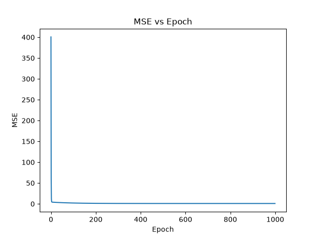
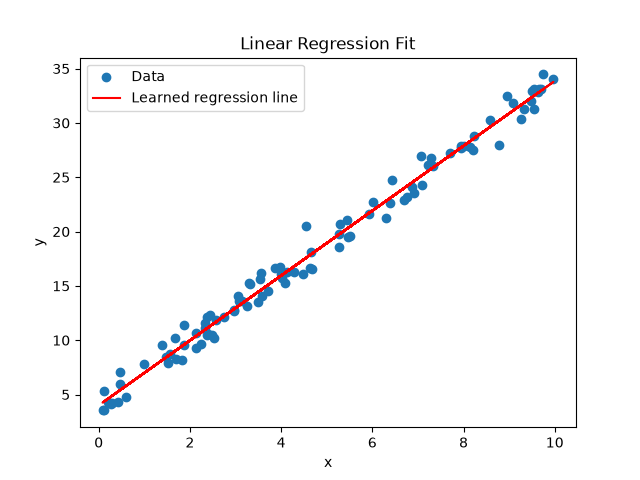
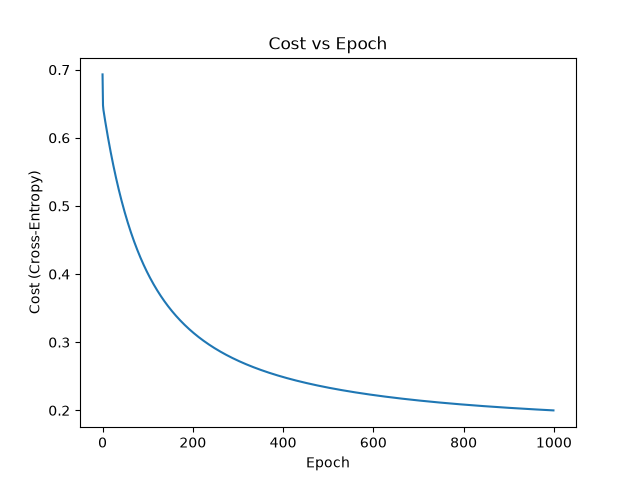
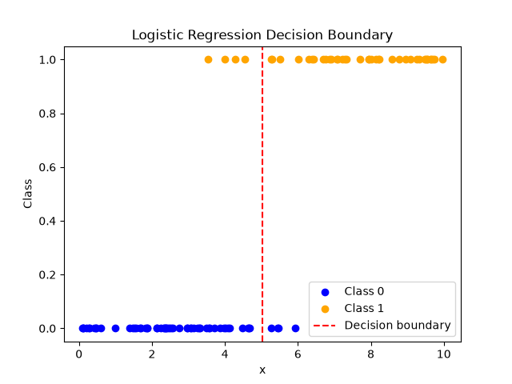

# Healthcare ML

This is a machine learning project built in Python, moving from first-principles implementations through to a research-grade healthcare capstone.

## How it works

**v0 and v0.5 are built entirely from scratch, in NumPy only, no scikit-learn, no PyTorch, no TensorFlow.** Linear regression, logistic regression, and (later) a feedforward neural network are implemented and derived by hand, including the gradient descent update rules. The goal of these two versions is genuine mathematical understanding of what a model is doing, not producing a working result quickly.

From v1 onward, the project moves to standard libraries for applied work, but the from-scratch foundation in v0 and v0.5 means every library call afterward is used with a real understanding of what it's automating underneath.

**v0 specifically** implements simple linear regression, $y = b_0 + b_1 x$, trained with gradient descent implemented entirely by hand, using vectorised NumPy operations and manually derived partial derivatives of the cost function $J(b_0, b_1)$. The full derivation of the gradients is written up in [derivation.md](derivation.md).

Synthetic data is generated from a known true relationship ($b_0 = 4$, $b_1 = 3$) plus Gaussian noise, so the model's learned parameters can be checked directly against a known ground truth rather than just visually inspected.

**Logistic regression** extends the same approach to binary classification, passing the linear combination through the sigmoid function $\sigma(z) = \frac{1}{1+e^{-z}}$ and using cross-entropy loss instead of MSE, since MSE doesn't optimise well for classification. Both the sigmoid derivative and the cross-entropy gradients were derived by hand, see [derivation.md](derivation.md) for the full working.

**Verification against scikit-learn.** Both implementations are checked against scikit-learn's `LinearRegression` and unpenalised `LogisticRegression` on the same data in [verify.py](verify.py). scikit-learn is only used as a reference answer there; the models themselves stay NumPy only. Results are in the Verification section below.

## v0 Results, Linear Regression (1000 epochs, learning rate 0.01)

| Parameter | True Value | Learned Value | scikit-learn (OLS) |
|-----------|-----------|----------------|--------------------|
| b0        | 4         | 4.005          | 4.019              |
| b1        | 3         | 2.986          | 2.984              |

## v0 Results, Logistic Regression (1000 epochs, learning rate 0.1)

| Parameter         | True Value | Learned Value | scikit-learn (MLE, no penalty) |
|-------------------|-----------|----------------|--------------------------------|
| b0                | -7.5      | -5.177         | -8.514                         |
| b1                | 1.5       | 1.030          | 1.672                          |
| Boundary (-b0/b1) | 5.000     | 5.025          | 5.093                          |

Training accuracy is 92% for both models.

## Verification against scikit-learn

Run with `python verify.py`. The comparison is against the exact optimum of the same objective, not against the true parameters. Noise in a sample of 100 points means even a perfect fit won't recover 4 and 3 (or -7.5 and 1.5) exactly, so the right question is whether gradient descent reaches the same answer as an exact solver.

For logistic regression this means using `LogisticRegression(penalty = None)`. scikit-learn's default adds an L2 penalty (C = 1.0), which is a different objective. On this data the default gives b0 = -7.635, b1 = 1.492, which happens to sit closer to the true values, but that's the penalty shrinking the coefficients, not a better fit of the model we wrote.

**Linear regression.** At the settings in `main.py` (1000 epochs, lr 0.01), b0 is 0.014 off the OLS solution and b1 is 0.002 off. With 5000 epochs both match to about 1e-12. So the implementation is correct; 1000 epochs just isn't quite enough for the intercept.

**Logistic regression.** At 1000 epochs (lr 0.1) the parameters are a long way from the maximum likelihood solution: b0 = -5.18 against -8.51. The decision boundary is still close (5.03 against 5.09) and accuracy is identical, which is why the plot looked right. With 50,000 epochs the parameters match to about 1e-6, and with 200,000 to about 1e-9, so again the gradients are correct and the gap is purely convergence.

| Epochs  | Logistic b0 | Logistic b1 | b0 gap to sklearn |
|---------|-------------|-------------|-----------------|
| 1,000   | -5.177      | 1.030       | 3.3             |
| 10,000  | -8.336      | 1.637       | 0.18            |
| 50,000  | -8.514      | 1.672       | 4e-6            |
| 200,000 | -8.514      | 1.672       | 4e-9            |

**Why it's slow: conditioning.** x runs from 0 to 10 and isn't centred, so b0 and b1 are strongly linked: raising the slope can be almost cancelled by lowering the intercept. The cost surface is a long, narrow valley. Gradient descent moves quickly across the valley and very slowly along it.

The Hessian makes this precise. For the MSE loss its eigenvalues are about 62.4 and 0.55, a ratio of about 113. Along the slow direction each step shrinks the error by a factor of 1 - lr × 0.55, so after 1000 steps only about 0.4% of the starting error is left there, which matches the 0.014 gap in b0. For the logistic loss at the optimum the ratio is about 500 and the small eigenvalue is about 0.0027, so after 1000 steps roughly 76% of the error in the slow direction is still there. That's why the logistic parameters are so far off.

Centring and scaling x before training would bring these ratios close to 1 and fix most of this. That's something to carry into v0.5.

## Observations

**v0 Observations, Linear Regression**

MSE drops sharply within roughly the first 100 epochs and looks flat after that. That turned out to be misleading: the verification shows b0 was still moving at epoch 1000. A flat loss curve means the loss has stopped changing much, not that the parameters have stopped changing. With a poorly conditioned problem, the parameters can drift along the bottom of the valley while the loss barely moves.

Both learned parameters land close to their true values (b0 within 0.005, b1 within 0.014). The b0 match is partly luck: the exact least-squares answer for this sample is 4.019, so the unconverged model happens to sit nearer the truth than the converged one would.

**v0 Observations, Logistic Regression**

The decision boundary lands almost exactly where the true parameters place it, with only a small number of points near the boundary misclassified, expected given the probabilistic overlap between classes so close to the 50/50 point.

The individual parameters are a different story. At 1000 epochs b0 and b1 are both well short of the maximum likelihood values. They are off in roughly the same proportion, so their ratio, which sets the boundary, is nearly right while the steepness of the sigmoid is too low. In other words, the model has the right boundary but is underconfident about it.

The cost curve was still decreasing at epoch 1000, and verification confirms this was a real convergence gap, not noise. It needs around 50,000 epochs at lr 0.1 to converge, for the conditioning reasons above.

## How to run

pip install numpy matplotlib

python main.py

To run the verification (needs scikit-learn, used only as a reference):

pip install scikit-learn

python verify.py

## What's next

- v0.5: from-scratch feedforward neural network with backpropagation, NumPy only
- v1a: tabular classification (UCI Heart Disease or Wisconsin Breast Cancer)
- v1b: CNN-based image classification (diabetic retinopathy or skin lesion data)
- v2: ICU mortality/sepsis prediction from PhysioNet Challenge data